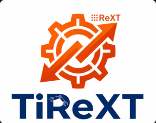
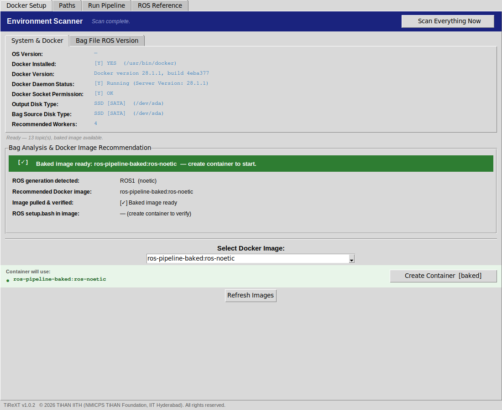
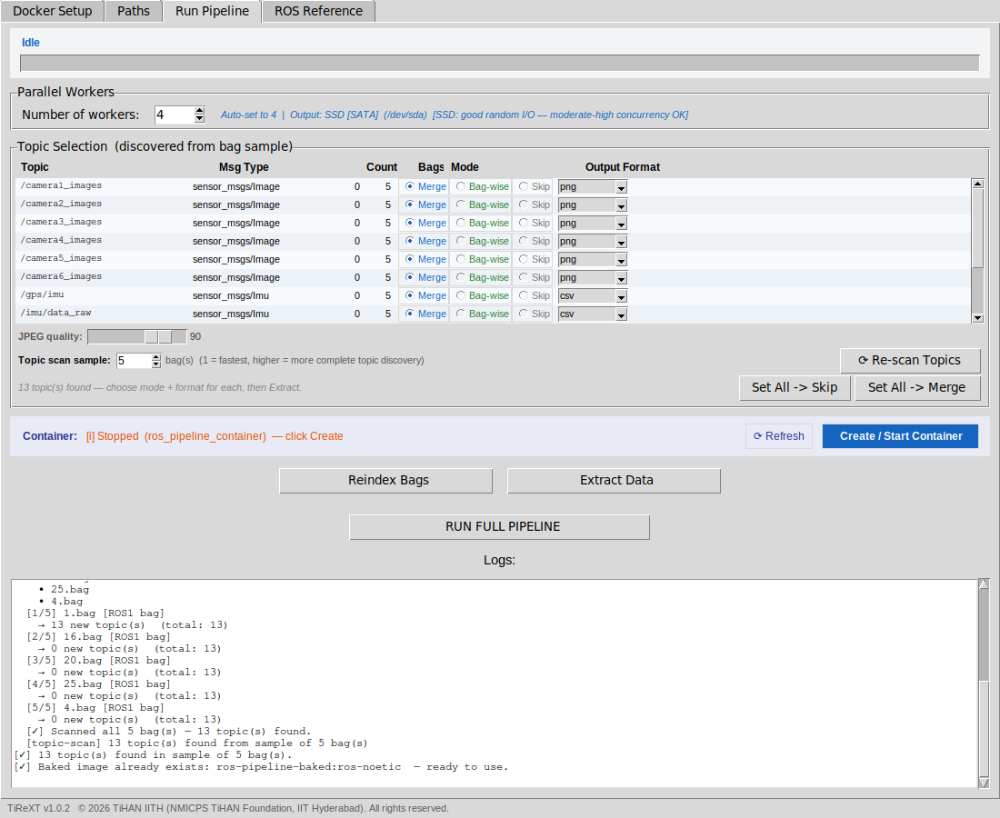
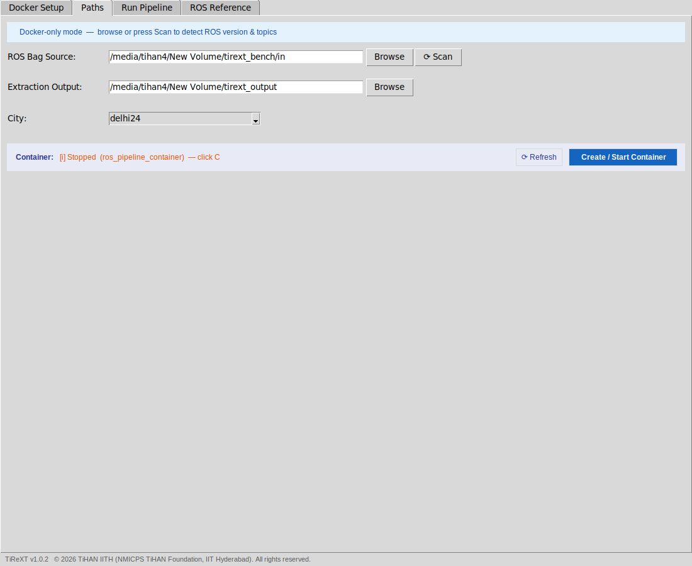
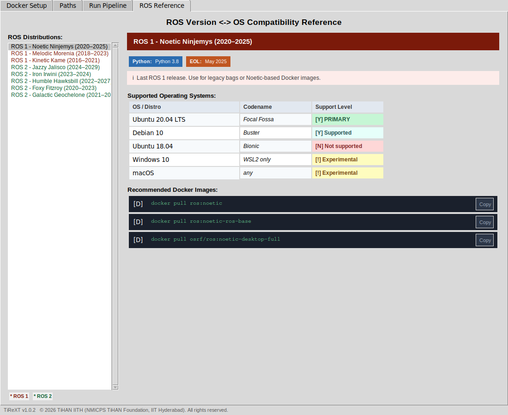
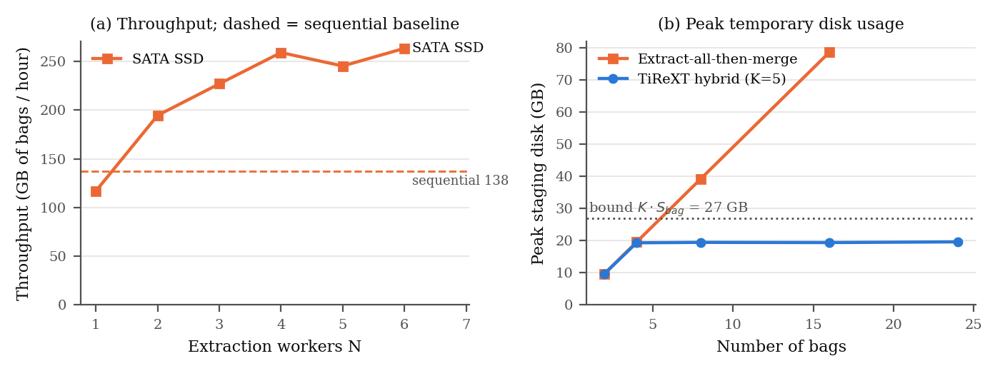

<p align="center"></p>

# TiReXT — ROS Extraction GUI tool

TiReXT turns large collections of ROS 1 and ROS 2 bag recordings from
instrumented vehicles (LiDAR, multi-camera rigs, radar, GPS/IMU,
hyperspectral) into analysis-ready files: PCD/BIN/PLY point clouds,
PNG/JPEG/TIFF image sequences and time-sorted CSV telemetry.

It accompanies the paper *"TiReXT: Bounded-Storage Parallel Extraction of
Multi-Sensor ROS Data for Autonomous Driving"*. This repository provides the
installable software, documentation and the benchmark results reported in
the paper. The source code is not published.

- **Bounded temporary storage.** A worker pool and one merge thread share a
  semaphore of capacity K, so at most K bags are ever staged on disk,
  whatever the size of the dataset.
- **Two-level resume.** Progress is tracked per bag and per topic, with
  configuration fingerprints, so a restart redoes only incomplete or
  reconfigured work.
- **ROS 1 and ROS 2 in one tool.** The ROS generation is detected from the
  file header, and every ROS operation runs inside Docker, so the host needs
  no ROS installation.
- **Sensor-aware routing.** A three-tier classifier (message type, verified
  topic keywords, live message inspection) picks an output format for every
  topic.

## Download

Get the latest version from the [Releases](../../releases) page.

| File | Use |
|---|---|
| `tirext_1.0.2_amd64.deb` | Ubuntu/Debian installer |
| `TiReXT-1.0.2-linux-x86_64.tar.gz` | portable build, no installation |
| `SHA256SUMS` | checksums for both files |

Requirements: 64-bit Linux (tested on Ubuntu 20.04) and Docker. If Docker is
missing or not configured, the first-run wizard installs and configures it.

```bash
# Option 1: install the .deb
sudo apt install ./tirext_1.0.2_amd64.deb
TiReXT

# Option 2: portable build
tar -xzf TiReXT-1.0.2-linux-x86_64.tar.gz
./TiReXT/TiReXT
```

On first use, *Scan Everything Now* builds a "baked" Docker image with every
dependency pre-installed. This needs network access once; later runs start in
seconds.

## The GUI

| Docker setup | Run pipeline |
|---|---|
|  |  |
| **Paths** | **ROS reference** |
|  |  |

1. **Docker Setup:** *Scan Everything Now* checks Docker, detects the ROS
   generation of your bags, recommends an image and builds the baked image.
2. **Paths:** choose the folder holding one sub-folder per recording session
   (e.g. per city) and an output folder.
3. **Run Pipeline:** pick the worker count (preset from the output disk
   type), set each topic to *Merge*, *Bag-wise* or *Skip*, choose its output
   format, then *Run Full Pipeline*. An interrupted run resumes where it
   stopped when started again.

### Output layout

```
<output>/<session>/
  merged/<topic>_<fmt>/           time-sorted across all bags (images + frames.csv, CSVs)
  bagwise/<topic>_<fmt>/bagNNN/   one folder per bag (LiDAR, radar, hyperspectral)
  progress.csv                    bag-level state, used for resume
```

## Benchmark results

The raw measurements behind these tables are in [`results/`](results/).

**Setup.** AMD Ryzen 5 5600G (6 cores / 12 threads), 14 GB RAM, Ubuntu 20.04,
Docker 28.1.1. Dataset: 2,642 ROS 1 bags, 13.39 TB, recorded in 13 Indian
cities by a vehicle carrying six cameras, a RoboSense LiDAR, Continental and
Navtech radars, and Novatel GPS/IMU. Throughput and disk tests use 12 (or up
to 24) recordings of about 5.4 GB from Delhi, with the GUI's default formats
(cameras and Navtech → PNG, LiDAR → PCD, radar → CSV, GPS/IMU → CSV). The
page cache of the input bags is dropped before every run. Each configuration
was run once.



### Throughput: SATA SSD, 12 bags (64.5 GB)

| Workers N | Sequential baseline | 1 | 2 | 3 | 4 | 5 | 6 |
|---|---|---|---|---|---|---|---|
| GB of bags / hour | 137.5 | 117.0 | 194.6 | 227.0 | **259.1** | 245.3 | 263.4 |
| Speed-up | 1.00× | 0.85× | 1.42× | 1.65× | **1.88×** | 1.78× | 1.92× |

The baseline runs the same conversion code one bag at a time (extract, merge,
next bag) in a single process.

### Peak temporary disk usage, N = 4, K = 5

| Bags | 2 | 4 | 8 | 16 | 24 |
|---|---|---|---|---|---|
| TiReXT (GB) | 9.7 | 19.3 | 19.5 | 19.4 | 19.6 |
| Extract-all-then-merge (GB) | 9.7 | 19.6 | 39.2 | 78.6 | — |

Staging stays below the bound K × S_bag = 26.9 GB regardless of dataset
size; extract-all-then-merge grows linearly.

### Fault-tolerant resume: 50 trials

The pipeline was killed with SIGKILL in each bag state, restarted and run to
completion. Every merged CSV had to contain exactly the rows of an
uninterrupted run, and every other file had to be byte-identical.

| Crash state | Correct | Median extra time |
|---|---|---|
| Extraction in progress | 10/10 | 0.4 s |
| Extraction done | 10/10 | 26.2 s |
| Merge in progress | 10/10 | 27.8 s |
| Merge done | 10/10 | 0.7 s |
| Failed (damaged bag) | 10/10 | 20.3 s |
| **Total** | **50/50** | |

These trials use four bags of about 1 GB each; an uninterrupted run takes 56 s.

### ROS-generation detection and topic classification: full dataset

| | Result |
|---|---|
| Files checked | 2,642 (13.39 TB) |
| Detected as ROS 1 | 2,640 / 2,640 bags; the 2 remaining files are empty and were rejected |
| Detection latency | median 8.1 ms, p99 30 ms per file |
| Distinct topics | 14 |
| Resolved by Tier 1 / 2 / 3 | 78.6% / 7.1% / 14.3% |
| Correct category | 14 / 14 |

## Copyright and licence

Copyright © 2026 TiHAN IITH (NMICPS TiHAN Foundation, IIT Hyderabad). All
rights reserved. Authors: Prof. Rajalakshmi Pachamuthu and Mr. Saurabh Dubey.
Copyright registration has been applied for.

The software is provided free of charge for use under the terms in
[LICENSE](LICENSE). For permissions or licensing enquiries, contact
ipr@tihaniith.in.
